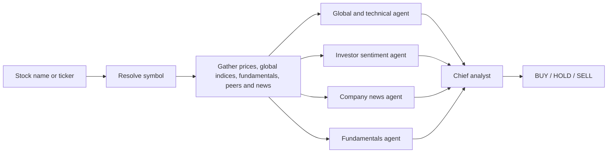

# stockdesk

`stockdesk` is a local, multi-agent stock research assistant for the NSE. Enter a company name or ticker and it returns one evidence-backed decision: **BUY**, **HOLD**, or **SELL**.

It does not ask for an email address, send messages, or place trades.

> This is a research tool, not investment advice. Market data can be delayed or incomplete.

## Architecture



The four specialist agents run in parallel through LangGraph:

- **Global and technical:** S&P 500, Nasdaq and VIX backdrop when available; price trend, moving averages, RSI, MACD, volume, relative strength and 52-week position.
- **Investor sentiment:** recency-weighted tone of recent headlines using a deterministic finance lexicon.
- **Company news:** earnings, guidance, order wins, ratings, regulation, management changes, promoter activity, M&A and capex.
- **Fundamentals:** ROE, leverage, growth, margins and valuation versus industry peers.

The chief analyst combines the reports with horizon-specific weights and deterministic risk rules. Strong disagreement, unreliable price data, low confidence, thin liquidity, material bad news, or an overextended setup can force a HOLD. OpenAI refines news classification and writes the explanation, but it cannot change the numerical decision. Without an API key, the deterministic analysis still works and uses a template-based explanation.

## Quick start

```bash
python -m venv .venv
source .venv/bin/activate

# Install every required library first
python -m pip install --upgrade pip
python -m pip install -r requirements.txt

# Install the stockdesk command without resolving dependencies again
python -m pip install --no-deps .

# Browser UI
stockdesk serve --open

# Or use the terminal
stockdesk check INFY
stockdesk check "tata motors" --horizon long --details
stockdesk
```

The browser opens at `http://localhost:8765`. The only required input is a stock name or ticker. You can optionally choose a time horizon:

- `swing`: weeks; market and news signals receive more weight.
- `positional`: months; balanced default.
- `long`: years; fundamentals receive the most weight.

To preview the full product without network access:

```bash
stockdesk demo
stockdesk serve --demo --open
```

## Output

Every result includes:

- one BUY, HOLD, or SELL verdict;
- an investor call with an indicative buy zone or entry trigger and a thesis-invalidation level;
- overall signal strength and confidence;
- the strongest evidence for and against the stock;
- conditions that would change the call;
- each specialist agent's score and rationale;
- linked news sources when available;
- an optional self-contained local HTML report (`--report`).

Recommendations are logged locally in `.stockdesk/ledger.sqlite` so they can be evaluated later against the benchmark:

```bash
stockdesk ledger
stockdesk ledger --score
```

## OpenAI setup

Create an OpenAI API key and add these values to `.env`:

```dotenv
OPENAI_API_KEY=your_api_key_here
OPENAI_MODEL=gpt-5.5
```

The API key stays on the local Python server and is never sent to the browser. The integration uses the OpenAI Responses API with response storage disabled. No downloaded model, GPU framework, or local model installation is needed.

## Configuration

Settings are optional and loaded from `.env`:

| Key | Default | Meaning |
|---|---|---|
| `MARKET` | `NSE` | Active market adapter |
| `UNIVERSE` | `nifty200` | Universe used for symbol lookup and peer selection |
| `DEFAULT_HORIZON` | `positional` | `swing`, `positional`, or `long` |
| `OPENAI_API_KEY` | empty | OpenAI API key; deterministic fallback is used when absent |
| `OPENAI_MODEL` | `gpt-5.5` | OpenAI model used for news refinement and explanations |
| `OPENAI_TIMEOUT_S` | `90` | OpenAI request timeout in seconds |
| `NEWS_LOOKBACK_DAYS` | `3` | Recent-news window |
| `DATA_DIR` | `.stockdesk` | Cache, reports, charts, and ledger |

No email or Gmail configuration is required.

## Data sources

- Yahoo Finance through `yfinance`: prices, global benchmarks, fundamentals, and some news.
- NSE and Nifty Indices: symbol lists and index constituents.
- Google News RSS: recent company headlines.

Free sources can fail or change without notice. Run `stockdesk doctor` to check the current setup.

## Tests

```bash
pytest -q
```

The offline suite covers the four agents, parallel orchestration, risk rules, symbol resolution, CLI, browser API, local reports, and recommendation scoring.

## Project layout

```text
src/stockdesk/
  cli.py                 terminal commands and interactive prompt
  flows/check.py         one stock -> one decision
  graph.py               LangGraph fan-out / fan-in orchestration
  agents/                specialist agents and chief analyst
  analysis/              indicators and sentiment models
  data/                  Yahoo, news and cache integrations
  markets/               market adapter interface and NSE implementation
  report/                chart and local HTML report
  web/                   zero-dependency local browser UI
  ledger.py              local recommendation history and scoring
```

## License

MIT
